<p align="center">
  <a href="../../README.md"></a>
  <a href="../../README_en.md"></a>
</p>

> 操作手册 · 阶段二 · 200 · ROS 接入 · [00 目录](00-目录.md) · [阶段一 106](106-样车验证.md) · [阶段三 300](300-导航.md)

---

# 200 ROS 接入

| 版本 | 日期 | 说明 |
|------|------|------|
| V1.0 | 2026-10-24 | Pi 5 + Jazzy，`/cmd_vel` → `c v w` 验收通过 |

**状态:已完成。**

固件仍是[DiffDrive](../../sketchbook/DiffDrive/DiffDrive.ino)。Windows等件: [tools/serial_teleop.py](../../tools/serial_teleop.py)。派上节点: [ros2/axion_serial_bridge](../../ros2/axion_serial_bridge)。Windows不装ROS2、不要 `colcon`。不要`do-release-upgrade`到26.04(Jazzy 只对 24.04)。

---

## 2.1 范围

Raspberry Pi 5 + Ubuntu 24.04 + Jazzy。固件仍是 DiffDrive。只做`/cmd_vel` → `c v w`。

---

## 2.1.1 接线 — 电源树

在主开关后并三路: 第一路和第二路即[104](104-电源定型.md)步骤`1.4.1`**保持不动**，新增第三路。

1. **第一路:**主开关后(OUT+ 12V) → 5V 固定降压板 → VIN 开关 → ESP32 VIN  
2. **第二路:**主开关后(OUT+ 12V) → 7～8V 可调降压板（LM2596）→ TB6612 VM  
3. **第三路(新增):**主开关后(OUT+ 12V) → 5V 铝壳降压板 → Type-C 公头 → 树莓派 5 USB-C  

三路**IN−**都接12V负(共地)。铝壳为非隔离, OUT− 即车地, 不必再拉一根到 ESP32。第三路**不经 VIN**。铝壳 OUT 先量约**5.1 V**(实测5.19V可)再插派。

**禁止:**12V进VIN/VM/Pi; VIN接通时再插USB(电脑或派)。

**派上开车:**主开关ON, VIN断开(或开关 OFF), 只插派 ↔ ESP32 USB。

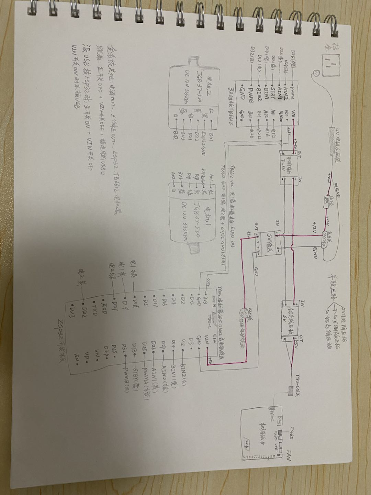

---

## 2.1.2 安装 Ubuntu 系统

1. 下载[Raspberry Pi Imager](https://www.raspberrypi.com/software/)(Windows用**Download for Windows**)。
2. 读卡器装入**Extreme A2 64G** microSD, 插入电脑 USB, 多一个盘(本机**F:**)。
3. 打开Imager, 设备选**Raspberry Pi 5**。

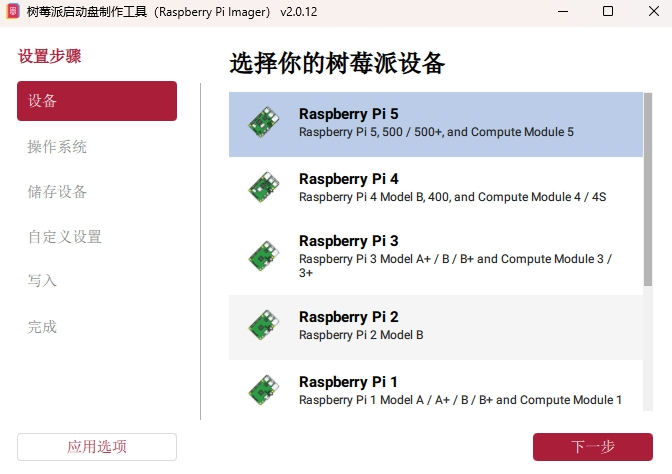

4. 操作系统: **Other general-purpose OS → Ubuntu → Ubuntu Server 24.04.5 LTS (64-bit)**。  
   - 不要选 Pi OS / Ubuntu Core。  
   - 不要升级到 26.04。

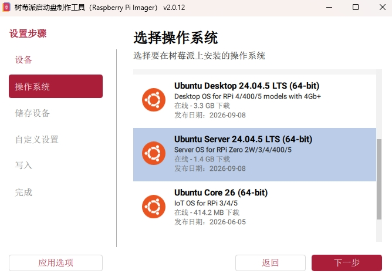

5. 存储设备选读卡器里那张卡(本机F:、约63.9GB), 勾选**排除系统驱动器**。

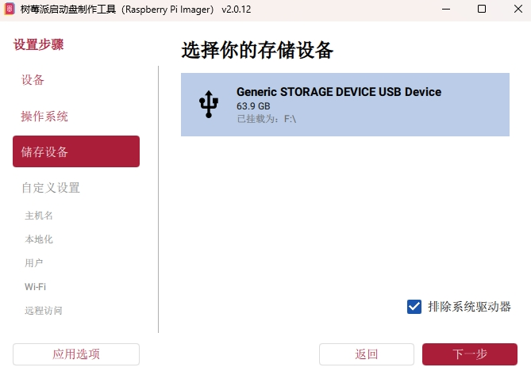

6. 自定义: 主机名、用户名(本机`axion`)、Wi-Fi、开启SSH(密码登录)。时区`Asia/Shanghai`。

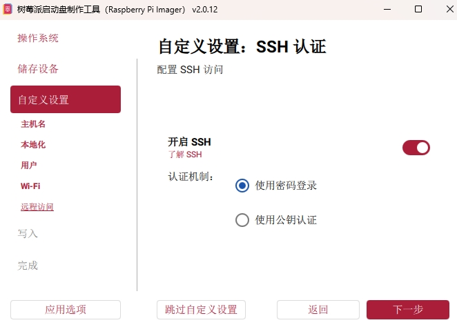

7. 确认摘要后写入。

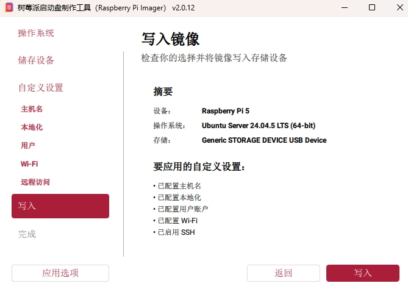

8. 提示将擦除该设备:点**我理解, 擦除并写入**。

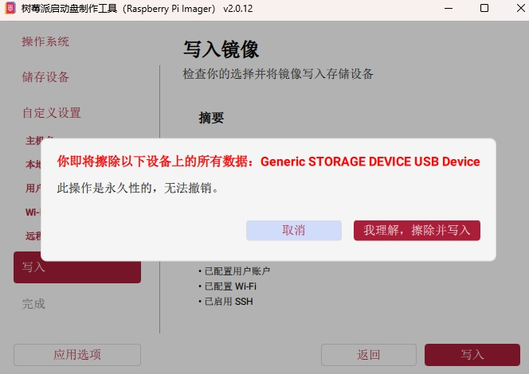

9. 等待镜像写入与校验。

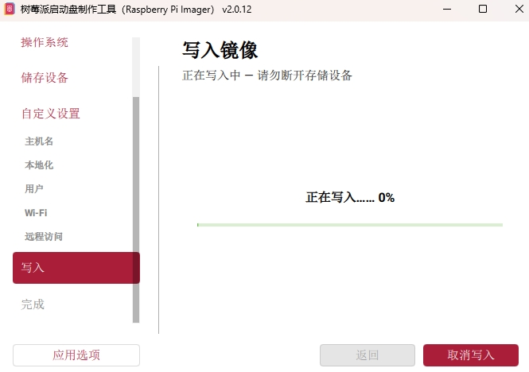

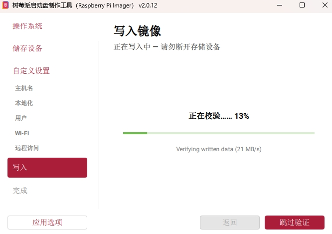

10. 写入完成，点结束。存储设备会自动弹出。

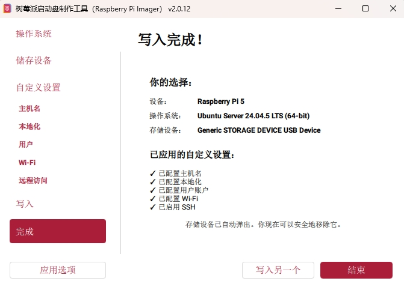

11. 将microSD插入Pi**背面**`SD CARD`卡槽。

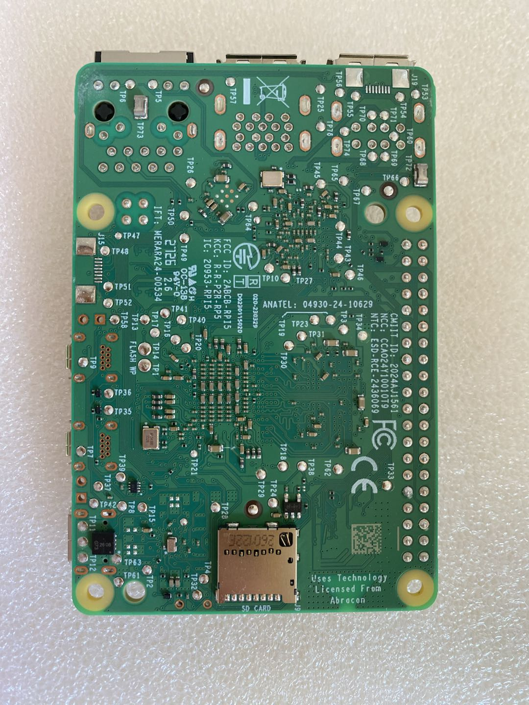

---

## 2.1.3 安装 Jazzy

1. Cooler 扣上, 风扇插板子丝印**FAN**的4针座。第三路Type-C接到Pi的USB-C(供电)。插之前再确认铝壳`OUT+ ≈ 5.1V`。

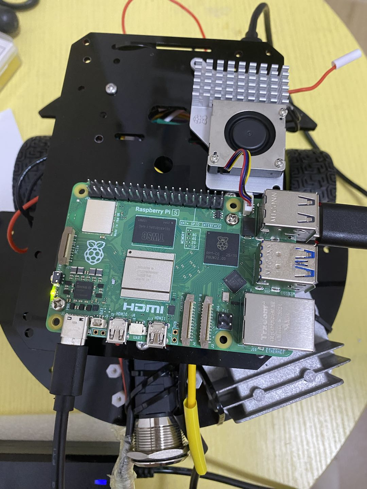

2. 主开关ON: 红灯亮、绿灯闪。等几秒, 同一`Wi-Fi`下：

```powershell
ping axion.local
ssh axion@axion.local
```

登录日志可能提示电源不是5A(非 PD)。CH340串口仍可用。若提示升26.04,忽略。

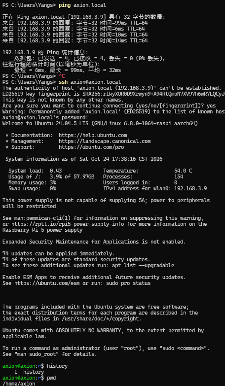

3. 允许USB拉电流(无 PD 时接串口):

```bash
echo "usb_max_current_enable=1" | sudo tee -a /boot/firmware/config.txt
```

改完先不重启, 装完ROS2再一起重启。

4. 装ROS2 Jazzy：

```bash
sudo apt update
sudo apt install -y software-properties-common curl
sudo curl -sSL https://raw.githubusercontent.com/ros/rosdistro/master/ros.key -o /usr/share/keyrings/ros-archive-keyring.gpg
echo "deb [arch=$(dpkg --print-architecture) signed-by=/usr/share/keyrings/ros-archive-keyring.gpg] http://packages.ros.org/ros2/ubuntu $(. /etc/os-release && echo $UBUNTU_CODENAME) main" | sudo tee /etc/apt/sources.list.d/ros2.list
sudo apt update
sudo apt install -y ros-jazzy-ros-base python3-colcon-common-extensions python3-serial
```

**本机坑:**默认`ubuntu.sources`只有`Suites: noble`, 运行库已是`*.1`补丁版, `-dev`对不上, 会出现:

`liblz4-dev : Depends: liblz4-1 (= 1.9.4-1build1) but 1.9.4-1build1.1 is to be installed`  
(`libzstd-dev` 同类。)

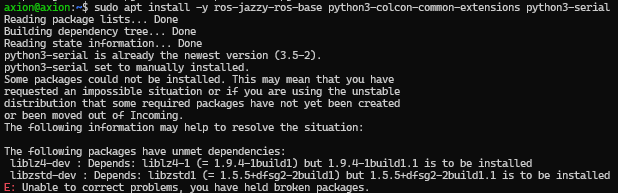

查看:

```bash
cat /etc/apt/sources.list.d/ubuntu.sources
```

实测(节选):第一段`Suites: noble`, 安全源是`noble-security`。把第一段改成带updates(不要改`noble-security`):

```bash
sudo sed -i 's/Suites: noble$/Suites: noble noble-updates/' /etc/apt/sources.list.d/ubuntu.sources
sudo apt update
sudo apt upgrade -y
```

若出现 `Could not get lock ... unattended-upgr`: 开机自动更新占着锁。

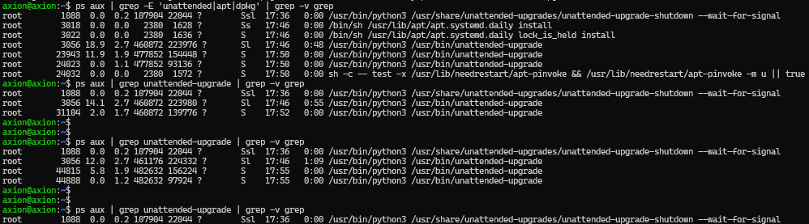

`Ctrl+C`自己这边的`apt`, 查进程:

```bash
ps aux | grep -E 'unattended|apt|dpkg' | grep -v grep
```

等到只剩`unattended-upgrade-shutdown --wait-for-signal`再继续。不要`kill`、不要拔电。

```bash
sudo apt upgrade -y
sudo apt install -y ros-jazzy-ros-base python3-colcon-common-extensions python3-serial
```

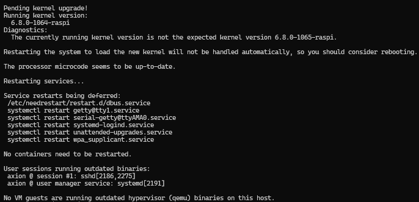

```bash
echo "source /opt/ros/jazzy/setup.bash" >> ~/.bashrc
source ~/.bashrc
```

`echo ... >> ~/.bashrc`**只写一次**(装成功后)。

5. 重启:

```bash
sudo reboot
```

再SSH登录到axion主机:

```bash
ssh axion@axion.local

echo $ROS_DISTRO
# 应输出 jazzy

ros2 --help
# 应看到 usage: ros2 ...
```

---

## 2.1.4 编译 ROS2 桥

派上:

```bash
sudo usermod -aG dialout axion
mkdir -p ~/axion_ws/src
exit
```

Windows(路径按本机仓库):

```powershell
scp -r D:\workspace\AxionRover\ros2\axion_serial_bridge axion@axion.local:~/axion_ws/src/
ssh axion@axion.local
```

`dialout`必须重新登录后再生效。然后:

```bash
source /opt/ros/jazzy/setup.bash
cd ~/axion_ws
colcon build --packages-select axion_serial_bridge
echo "source ~/axion_ws/install/setup.bash" >> ~/.bashrc
source ~/axion_ws/install/setup.bash
```

---

## 2.1.5 按键验收

1. 主开关**ON**, 电脑USB**拔掉**。  
2. 派USB-A ↔ ESP32 Type-C, **VIN断开/开关OFF**。轮子离地。

```bash
ls /dev/ttyUSB* /dev/ttyACM*
```

本机只有 `/dev/ttyUSB0`。`ttyACM*` 没有是正常的(CH340)。

三个SSH窗口:

**C — 监听话题**

```bash
ros2 topic echo /cmd_vel
```

**A — 桥**(只在启动时打一行`serial /dev/ttyUSB0 115200`, 不会刷固件`OK v=`)

```bash
ros2 run axion_serial_bridge cmd_vel_serial --ros-args -p port:=/dev/ttyUSB0
```

**B — 键盘**(窗口要点一下才吃按键; 默认`speed 0.5`偏快, 地上先按几次`x`)

```bash
sudo apt install -y ros-jazzy-teleop-twist-keyboard
ros2 run teleop_twist_keyboard teleop_twist_keyboard
```

`i` / `j` / `l` 轮子转动, **空格键停**。这是`teleop_twist_keyboard`的设计: 松开键不会自动发0, 和Windows`serial_teleop.py`(按住走、松开发`0`)不同。

`echo`里应看到`linear.x`/`angular.z`随按键变。差速车只用这两项:`x`前进(m/s),`z`偏航(rad/s)。

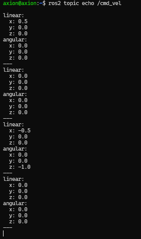

结束: 先停终端B,再停A(节点退出会写一次`0`)。

---

## 2.1.6 通过标准

- 按 `i` / `j` / `l` / `m` 轮子转动, **空格键停**。  
- `ros2 topic echo /cmd_vel`里`linear.x`/`angular.z`随按键变。

演示：[YouTube](https://www.youtube.com/shorts/JJ2JFrDMi3Q) · [Bilibili](https://www.bilibili.com/video/BV1NEHg64Ecr/)